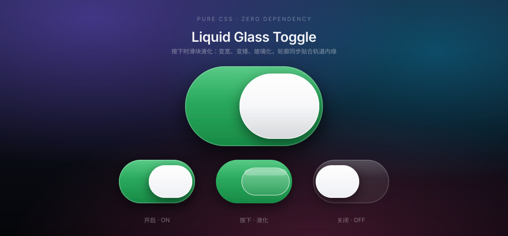

# Liquid Glass Toggle

**iOS 26 风格液态玻璃开关 · 纯 CSS · 零依赖 · 非商业使用**

按下去，滑块不再是一块死白的圆角矩形——它会变宽、变矮、失去实心，变成一层能透出背后壁纸的薄玻璃，
描边同时收紧、贴合轨道内缘；松手后液体回弹。整个交互只用了 `transition` 的时序编排，没有一行 JS 参与。

[](#许可证)
[](#)
[](#)
[](https://github.com/OStarsO/liquid-glass-toggle/actions/workflows/pages.yml)



## 预览

**即时在线预览（无需任何配置）**
https://raw.githack.com/OStarsO/liquid-glass-toggle/main/index.html

**GitHub Pages**
https://ostarso.github.io/liquid-glass-toggle/
— 需先在仓库 `Settings → Pages → Source` 选择 **GitHub Actions**，之后每次 push 自动部署。
未启用时部署流水线会自动跳过，不会报错。

**本地预览**
直接双击 `index.html`；或 `python -m http.server 8000` 后访问 `http://localhost:8000`。

演示页包含：主开关（自动循环演示按下态）、三种尺寸变体、设置项场景、强调色切换、
四款壁纸（玻璃需要背景才有可折射的内容）。

## 快速开始

```html
<link rel="stylesheet" href="src/liquid-glass-toggle.css" />

<label class="lg-switch">
  <input type="checkbox" checked aria-label="开关" />
  <span class="lg-switch__track">
    <span class="lg-switch__thumb"></span>
  </span>
</label>
```

三层结构不能少：`input` 必须是 `track` 的**前一个兄弟节点**（CSS 用 `input:checked + .lg-switch__track` 驱动），
`thumb` 放在 `track` 内部。

## 尺寸与主题

内置三档尺寸：

| 类名 | 轨道 | 滑块 | 说明 |
| --- | --- | --- | --- |
| `.lg-switch--sm` | 72 × 40 | 40 × 24 | 设置列表行内 |
| `.lg-switch` | 112 × 64 | 64 × 48 | 默认 |
| `.lg-switch--lg` | 152 × 88 | 88 × 72 | 主视觉 / 强调 |

自定义尺寸时只需给三个量，位移和按下形变会自动推导：

```css
.lg-switch--xl {
  --lg-w: 200px;        /* 轨道宽 */
  --lg-h: 116px;        /* 轨道高 */
  --lg-thumb-w: 116px;  /* 滑块宽 */
}
```

可用变量：

| 变量 | 默认值 | 作用 |
| --- | --- | --- |
| `--lg-w` / `--lg-h` | `112px` / `64px` | 轨道尺寸 |
| `--lg-thumb-w` | `64px` | 滑块宽度（高度自动推导） |
| `--lg-pad` | `4px` | 滑块与轨道内缘的留白 |
| `--lg-border` | `1px` | 轨道描边宽度（参与位移计算，改宽度时无需再调位移） |
| `--lg-accent` | `rgba(34, 180, 80, 0.55)` | 开启态轨道颜色 |
| `--lg-accent-stroke` | `rgba(255, 255, 255, 0.22)` | 开启态轨道描边 |
| `--lg-press` | `6px` | 按下时横向膨胀量 |
| `--lg-press-shorten` | `8px` | 按下时纵向收缩量 |

派生量（不要手改）：

```css
/* 轨道内容宽 = W − 边框×2；滑到最右时左右各留 --lg-pad */
--lg-travel: calc(var(--lg-w) - var(--lg-thumb-w) - var(--lg-pad) * 2 - var(--lg-border) * 2);
--lg-thumb-h: calc(var(--lg-h) - var(--lg-pad) * 2 - 8px);
```

## 为什么像液体

关键在于**两段式时序**，而不是某条缓动曲线：

1. 常态转按下：所有属性统一 0.12s，瞬间响应，像被指尖压住。
2. 按下转常态 / 切换：位移 `0.35s cubic-bezier(0.34, 1.42, 0.64, 1)` 立刻出发，
   而宽高、背景、阴影、backdrop-filter 全部延迟 `0.22s` 才启动。

于是滑块先滑到位，形状稍后才跟上——这就是“液体被拖拽后回弹”的错觉。
`cubic-bezier(0.34, 1.42, 0.64, 1)` 的 1.42 超调量负责那个轻微的过冲。

其它细节：

- `outline-offset: -1.5px` 让描边画在元素**内侧**，形变时描边跟着收缩，永不溢出。
- 按下态 `backdrop-filter: blur(24px) saturate(160%)` 配合四层 `inset` 高光，玻璃才有厚度。
- 开启态位移 = `--lg-travel`，按下开启态位移 = `--lg-travel - --lg-press`，右侧始终贴住内缘。
- 需要脚本复用按下态时，给 `.lg-switch` 加 `is-pressing` 类即可（演示页的自动循环就是这么做的）。

## 可访问性

- 由真实 `<input type="checkbox">` 驱动，Tab 可聚焦、空格可切换，屏幕阅读器语义正确。
- `focus-visible` 有独立焦点环（`outline: 2px solid`，`offset: 4px`）。
- `prefers-reduced-motion: reduce` 下过渡被压到 0.01ms，不再形变。
- 不支持 `backdrop-filter` 的浏览器回退为实色底，开关功能不受影响。

## 浏览器支持

Chrome / Edge 76+、Safari 15.4+、Firefox 103+（`backdrop-filter` 全量支持）。
移动端 iOS Safari 与 Android Chrome 均正常；`-webkit-` 前缀已同时声明。

## 文件结构

```
liquid-glass-toggle/
├── index.html                     演示页
├── src/liquid-glass-toggle.css    组件本体（唯一必需文件）
├── docs/preview.svg               预览图
├── tests/geometry-check.html      几何留白自检
├── .github/workflows/pages.yml    GitHub Pages 自动部署
├── LICENSE
└── README.md
```

## 几何自检

`tests/geometry-check.html` 用 `getBoundingClientRect()` 逐个量出各尺寸在开启 / 关闭 / 按下三种状态下的
滑块左右上下留白，并检查是否溢出轨道。浏览器打开后页面底部会打印 `RESULT_BEGIN … RESULT_END`：

```
md-on    ON  track=112.00x64.00 thumb=64.00x48.00 gapL=42.00 gapR=4.00 gapT=7.00 gapB=7.00 ok
md-off   OFF track=112.00x64.00 thumb=64.00x48.00 gapL=4.00  gapR=42.00 gapT=7.00 gapB=7.00 ok
press-on ON  track=112.00x64.00 thumb=70.00x40.00 gapL=36.00 gapR=4.00 gapT=11.00 gapB=11.00 ok
```

规则很硬：开启态右侧必须留 `--lg-pad` 且不得溢出——任何一行出现 `OVERFLOW` 就是位移公式被改坏了。

## 许可证

**非商业使用（Non-Commercial）** —— 允许个人学习、研究、修改、二次创作与分发；
**禁止任何形式的商业用途**，包括但不限于：商业产品内置、付费项目、客户交付、
SaaS 服务、NFT 与周边售卖、以及任何以营利为目的的再分发。

商业授权需另行联系作者。详见 [LICENSE](LICENSE)。

---

作者 [@OStarsO](https://github.com/OStarsO) · 非商业项目
